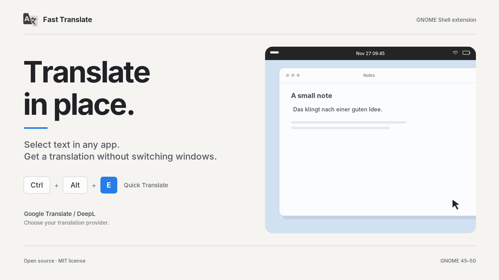
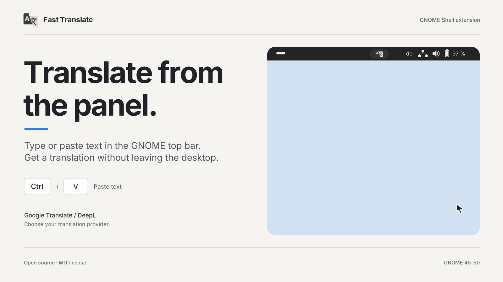

<div align="center">
  
  <h1>Fast Translate</h1>
  <p>Translate selected text in a floating popup or enter text in the GNOME top bar.</p>
  <p><strong>GNOME Shell 45–50</strong> · Google Translate &amp; DeepL · <a href="LICENSE">MIT</a></p>
  <p><a href="#install">Install</a> · <a href="#how-to-use">How to use</a> · <a href="#translation-services">Translation services</a></p>
</div>



## Install

On a GNOME Shell 45–50 desktop, install Git, Node.js with npm, Python 3 with `venv` support, and the tools `gnome-extensions`, `glib-compile-schemas`, `msgfmt` (gettext), and `unzip`.

```bash
git clone https://github.com/holodsasha170804-afk/fast-translate.git
cd fast-translate
npm run deploy
```

The deploy script builds, installs, and enables the extension for your user. If the icon does not appear, sign out of GNOME and sign back in. Use **Settings** at the bottom of the top-bar popup or open **Fast Translate** in the **Extensions** app to change preferences.

## How to use

### Translate selected text

Select text in an app and press <kbd>Ctrl</kbd> + <kbd>Alt</kbd> + <kbd>E</kbd>. The translation appears in a floating popup near the pointer, while your app keeps focus. Change the keyboard shortcut in **Quick Translate** preferences.

Enable **Run in Background** to copy the translation directly to your clipboard. Paste it with <kbd>Ctrl</kbd> + <kbd>V</kbd>. **Background Notification** controls whether GNOME shows the result in a notification.

### Translate from the top bar

Click the **Fast Translate** icon. Type or paste text, pick your languages, and select **Translate**. Turn on **Auto Paste** to load clipboard text when the popup opens, **Auto Translate** to translate as you type, or **Auto Copy** to copy the result automatically.

<details>
<summary>Watch the top-bar demo</summary>



</details>

### Read aloud

Click the speaker next to the original or translated text. Playback supports up to 500 Unicode characters and requires `gst-play-1.0` with GStreamer MP3 playback support.

## Translation services

Translation and read aloud require an internet connection.

| Service | Setup |
| --- | --- |
| **Google Translate** | Enabled by default, with no API key. It uses an unofficial endpoint that can rate-limit requests. If you get HTTP 429, try again later. |
| **DeepL API Free or Pro** | Select **DeepL** in preferences and enter your [DeepL API key](https://developers.deepl.com/docs/getting-started/auth). The default URL is for API Free. For API Pro, set **DeepL → Advanced → API URL** to `https://api.deepl.com/v2/translate`. |

### Clipboard and privacy

Quick Translate sends one <kbd>Ctrl</kbd> + <kbd>C</kbd> to the active app and reads the resulting clipboard text. Pasting in the top-bar popup reads the clipboard, as does opening the popup with **Auto Paste** enabled. Copy, Auto Copy, and background mode write the translation to it.

Translation sends text to your selected provider. Read aloud uses Google’s online speech service, including when DeepL handles the translation. If the speech language is unknown, Google detects it from the text.

## Development

Run these commands from the project directory.

| Command | What it does |
| --- | --- |
| `npm run build` | Package the extension and run the static analyzer. |
| `npm run apply` | Validate and install the current package, then reload the extension. |
| `npm run deploy` | Build and apply in one step. |
| `npm test` | Run the fast suite. Requires GJS and a freshly built package. |
| `npm run test:integration` | Run the integration suite in an isolated GNOME Shell session. |

The build and install scripts stage files in temporary directories. Use them for all packaging and local installs. See [AGENTS.md](AGENTS.md) for development and testing details.

## Credits

Based on [Translate Assistant by Lorenzo Carbonell Cerezo](https://github.com/atareao/translate-assistant) and [Fast Translate by tazztone](https://github.com/tazztone/fast-translate). Thanks to everyone who contributed to both projects.

Released under the [MIT License](LICENSE).
